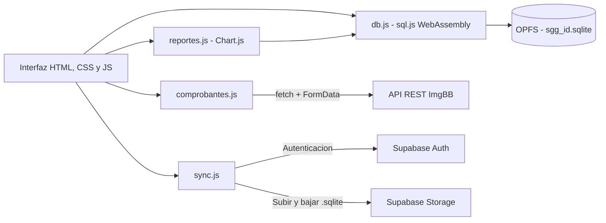

# Documento Técnico de Ingeniería — Sistema de Gestión de Gastos (SGG)
 
| | |
|---|---|
| **Proyecto** | Sistema de Gestión de Gastos (SGG) — Refactorización de Arquitectura y Trazabilidad E2E |
| **Autor** | Luciano Cabaña |
| **Rama de desarrollo** | `feature/refactor-sqlite-cabaña` |
| **Versión** | 2.0 |
| **Fecha** | 23/11/2026 |
| **Normas aplicadas** | ISO/IEC/IEEE 29148 (ERS y Casos de Uso) · ISO/IEC/IEEE 29119-3 (Documentación de pruebas) |
 
---
 
## 1. Introducción
 
### 1.1 Propósito
Este documento especifica los requerimientos de la versión 2.0 del SGG y garantiza la trazabilidad End-to-End entre Requerimientos Funcionales (RF), Casos de Uso (CU) y Casos de Prueba (CP).
 
### 1.2 Alcance
El SGG permite a un usuario autenticado registrar ingresos y egresos, consultar su balance, adjuntar comprobantes, visualizar reportes gráficos y respaldar su base de datos en la nube para usarla desde cualquier dispositivo. Funciona sin conexión una vez que la base está instalada en el navegador (offline-first).
 
### 1.3 Definiciones
 
| Término | Significado |
|---|---|
| **sql.js** | Motor SQLite compilado a WebAssembly que corre dentro del navegador. |
| **OPFS** | *Origin Private File System*: sistema de archivos privado del navegador, accedido con `navigator.storage.getDirectory()`. |
| **BaaS** | *Backend as a Service*. Se usa Supabase (Auth y Storage). |
| **RLS** | *Row Level Security*: políticas que restringen el acceso a cada usuario a su propia carpeta del bucket. |
| **Baja lógica** | Marcar un registro como inactivo (`activo = 0`) sin eliminarlo físicamente. |
 
### 1.4 Referencias
ISO/IEC/IEEE 29148:2018 · ISO/IEC/IEEE 29119-3:2021 · Documentación de sql.js, Chart.js, Supabase y API de ImgBB.
 
---
 
## 2. Descripción general
 
### 2.1 Arquitectura
 

 
| Módulo | Responsabilidad |
|---|---|
| `index.html` / `auth.js` | Registro e inicio de sesión (Supabase Auth). |
| `dashboard.html` / `gastos.js` | Interfaz de movimientos, balance y respaldo. |
| `db.js` | Esquema SQL, consultas y persistencia del binario `.sqlite` en OPFS. |
| `reportes.js` | Gráficos Chart.js alimentados con consultas `GROUP BY` / `SUM`. |
| `comprobantes.js` | Subida de imágenes a la API REST externa. |
| `sync.js` | Autenticación y respaldo/restauración en Supabase Storage. |
 
### 2.2 Usuarios
**Usuario autenticado**: persona mayor de 18 años con cuenta en el sistema. Actores secundarios: Supabase (Auth y Storage) e ImgBB.
 
### 2.3 Restricciones
- Prohibido usar `localStorage` o `sessionStorage` para persistir registros o el binario de la base.
- Prohibido el `DELETE` físico sobre la tabla de movimientos.
- Prohibido guardar imágenes o Base64 en SQLite: solo se almacena la URL pública.
- Navegadores recomendados: Chrome y Edge (soporte completo de OPFS).
---
 
## 3. Requerimientos funcionales
 
| ID | Requerimiento | Prioridad |
|---|---|---|
| **RF-01** | El sistema debe permitir registrar una cuenta (solo mayores de 18 años, con contraseña que cumpla 8+ caracteres, mayúscula, minúscula, número y símbolo) e iniciar sesión mediante Supabase Auth. | Alta |
| **RF-02** | El sistema debe persistir los datos en una base SQLite (sql.js) almacenada como archivo binario en OPFS, un archivo por usuario. | Alta |
| **RF-03** | El sistema debe permitir registrar y editar movimientos con tipo (`ingreso` / `egreso`), monto mayor a cero, fecha, categoría y descripción. | Alta |
| **RF-04** | El sistema debe calcular dinámicamente el balance general (ingresos − egresos) de los movimientos activos y permitir filtrar por categoría. | Alta |
| **RF-05** | El sistema debe eliminar movimientos mediante baja lógica (`activo = 0`), con confirmación previa, y rechazar cualquier `DELETE` físico. | Alta |
| **RF-06** | El sistema debe permitir adjuntar opcionalmente una imagen de comprobante, subiéndola a una API REST externa con `fetch` y `FormData`, y guardar solo la URL resultante. Ante una falla debe notificar al usuario y permitir guardar con URL `NULL`. | Alta |
| **RF-07** | El sistema debe mostrar un gráfico de dona (egresos por categoría) y uno de barras (ingresos vs. egresos), alimentados por consultas SQL de agregación. | Media |
| **RF-08** | El sistema debe respaldar el archivo `.sqlite` en Supabase Storage y, al iniciar sesión en un dispositivo sin base local, descargarlo e instalarlo automáticamente en OPFS. | Alta |
 
## 4. Requerimientos no funcionales
 
| ID | Requerimiento |
|---|---|
| **RNF-01** | **Seguridad:** cada usuario solo accede a su carpeta del bucket mediante políticas RLS; la clave secreta de Supabase no se incluye en el código del cliente. |
| **RNF-02** | **Disponibilidad offline:** con la base instalada en OPFS, el sistema opera sin conexión; el respaldo se reintenta luego. |
| **RNF-03** | **Auditabilidad:** ningún registro se elimina físicamente; un trigger de la base lo impide. |
| **RNF-04** | **Integridad:** restricciones `CHECK` en la base (`monto > 0`, `tipo_movimiento` válido) además de las validaciones de interfaz. |
| **RNF-05** | **Seguridad de interfaz:** los textos mostrados se escapan para evitar inyección de HTML. |
 
---
 
## 5. Casos de Uso
 
### CU-01 — Autenticar usuario
 
| Campo | Detalle |
|---|---|
| **Código** | CU-01 |
| **Nombre** | Autenticar usuario (registro e inicio de sesión) |
| **Actor Principal** | Usuario. Secundario: Supabase Auth |
| **Precondiciones** | El navegador tiene conexión a internet. El proyecto Supabase está configurado. |
| **Flujo Principal** | 1. El usuario abre `index.html`.<br>2. Elige «Regístrate aquí» y completa nombre, apellido, fecha de nacimiento, correo y contraseña.<br>3. El sistema valida campos obligatorios, mayoría de edad, requisitos de contraseña y coincidencia.<br>4. El sistema registra la cuenta en Supabase Auth.<br>5. El sistema abre la sesión y redirige al dashboard.<br>*(Inicio de sesión: el usuario ingresa correo y contraseña, Supabase los valida y el sistema redirige al dashboard.)* |
| **Flujos Alternativos / Excepción** | 3a. Menor de 18 años, contraseña inválida o no coincidente: se muestra el error y no se crea la cuenta.<br>4a. Correo ya registrado: se muestra el error.<br>4b. Sin conexión: se muestra «No hay conexión con el servidor».<br>Login: credenciales incorrectas muestran «Correo electrónico o contraseña incorrectos». |
| **Postcondiciones** | Existe una sesión activa identificada por el id de usuario de Supabase. |
 
### CU-02 — Persistir datos en SQLite sobre OPFS
 
| Campo | Detalle |
|---|---|
| **Código** | CU-02 |
| **Nombre** | Persistir datos en SQLite sobre OPFS |
| **Actor Principal** | Usuario autenticado |
| **Precondiciones** | Sesión activa. Navegador con soporte de OPFS. |
| **Flujo Principal** | 1. El usuario abre el dashboard.<br>2. El sistema inicializa sql.js (`initSqlJs`).<br>3. El sistema busca `sgg_<id_usuario>.sqlite` en OPFS; si existe lo abre, si no crea una base nueva.<br>4. El sistema ejecuta `CREATE TABLE IF NOT EXISTS` y crea el trigger anti-borrado.<br>5. Tras cada `INSERT` o `UPDATE`, el sistema exporta el binario y lo escribe en OPFS. |
| **Flujos Alternativos / Excepción** | 3a. El navegador no soporta OPFS: se informa el error.<br>5a. Falla la escritura: se informa el error y los datos permanecen en memoria durante la sesión. |
| **Postcondiciones** | El archivo `.sqlite` queda persistido en OPFS. No se usa `localStorage` para registros. |
 
### CU-03 — Registrar y editar movimiento
 
| Campo | Detalle |
|---|---|
| **Código** | CU-03 |
| **Nombre** | Registrar y editar movimiento |
| **Actor Principal** | Usuario autenticado |
| **Precondiciones** | Base de datos inicializada (CU-02). |
| **Flujo Principal** | 1. El usuario abre «Ingresar movimiento».<br>2. Elige el tipo (ingreso o egreso) y completa monto, fecha, categoría y descripción.<br>3. Toca «Guardar movimiento».<br>4. El sistema valida los datos.<br>5. El sistema ejecuta `INSERT` con `activo = 1`.<br>6. El sistema muestra la lista actualizada.<br>*(Edición: el usuario toca «Editar», modifica los datos y el sistema ejecuta `UPDATE`.)* |
| **Flujos Alternativos / Excepción** | 4a. Monto menor o igual a cero, fecha, categoría o descripción vacías: se muestra el error y no se guarda. |
| **Postcondiciones** | El movimiento existe en la tabla con `activo = 1` y se programa el respaldo en la nube (CU-08). |
 
### CU-04 — Consultar balance general
 
| Campo | Detalle |
|---|---|
| **Código** | CU-04 |
| **Nombre** | Consultar balance general |
| **Actor Principal** | Usuario autenticado |
| **Precondiciones** | Base de datos inicializada. |
| **Flujo Principal** | 1. El usuario abre «Consultar balance».<br>2. El sistema ejecuta `SUM` con `CASE` sobre movimientos activos.<br>3. El sistema muestra el balance (ingresos − egresos).<br>4. Opcionalmente, el usuario filtra por categoría y el sistema muestra cantidad, ingresos y egresos de esa categoría. |
| **Flujos Alternativos / Excepción** | 2a. Sin movimientos: se muestra `$0.00`.<br>3a. Balance negativo: se muestra con signo menos. |
| **Postcondiciones** | No se modifica ningún dato. |
 
### CU-05 — Eliminar movimiento (baja lógica)
 
| Campo | Detalle |
|---|---|
| **Código** | CU-05 |
| **Nombre** | Eliminar movimiento mediante baja lógica |
| **Actor Principal** | Usuario autenticado |
| **Precondiciones** | Existe al menos un movimiento activo. |
| **Flujo Principal** | 1. En «Ver movimientos», el usuario toca «Eliminar».<br>2. El sistema muestra un cuadro de confirmación.<br>3. El usuario confirma.<br>4. El sistema ejecuta `UPDATE movimientos SET activo = 0`.<br>5. El sistema recarga la vista. |
| **Flujos Alternativos / Excepción** | 3a. El usuario cancela: no se modifica nada.<br>4a. Si se intenta un `DELETE` físico, el trigger lo aborta con un error. |
| **Postcondiciones** | La fila sigue existiendo con `activo = 0` y queda excluida de la lista, el balance y los reportes. |
 
### CU-06 — Adjuntar comprobante
 
| Campo | Detalle |
|---|---|
| **Código** | CU-06 |
| **Nombre** | Adjuntar comprobante mediante API REST externa |
| **Actor Principal** | Usuario autenticado. Secundario: API ImgBB |
| **Precondiciones** | Formulario de movimiento abierto. |
| **Flujo Principal** | 1. El usuario selecciona una imagen en el campo «Comprobante».<br>2. Toca «Guardar movimiento».<br>3. El sistema valida tipo (JPG, PNG, WEBP, GIF) y tamaño (máx. 5 MB).<br>4. El sistema envía la imagen con `fetch` y `FormData` a la API.<br>5. La API devuelve la URL pública.<br>6. El sistema guarda el movimiento con esa URL en `url_comprobante`.<br>7. La tabla muestra el enlace «Ver». |
| **Flujos Alternativos / Excepción** | 3a. Tipo o tamaño inválido: se informa el motivo.<br>4a. Falla de red, rechazo de la API o tiempo agotado: se captura la excepción (`try/catch`), se notifica y se ofrece guardar sin comprobante; si acepta, `url_comprobante = NULL`; si cancela, no se guarda.<br>Sin imagen adjunta: el movimiento se guarda con `NULL`. |
| **Postcondiciones** | En SQLite solo se almacena la URL o `NULL`; nunca la imagen ni Base64. |
 
### CU-07 — Visualizar reportes
 
| Campo | Detalle |
|---|---|
| **Código** | CU-07 |
| **Nombre** | Visualizar reportes gráficos |
| **Actor Principal** | Usuario autenticado |
| **Precondiciones** | Base de datos inicializada. |
| **Flujo Principal** | 1. El usuario abre «Ver reportes».<br>2. El sistema ejecuta `SELECT categoria, SUM(monto) ... GROUP BY categoria` sobre egresos activos.<br>3. El sistema ejecuta `SELECT tipo_movimiento, SUM(monto) ... GROUP BY tipo_movimiento`.<br>4. El sistema dibuja con Chart.js la dona y el gráfico de barras. |
| **Flujos Alternativos / Excepción** | 2a. Sin egresos: se muestra el aviso «Todavía no hay egresos para graficar».<br>4a. Chart.js no carga: se registra el error en consola. |
| **Postcondiciones** | No se modifica ningún dato. |
 
### CU-08 — Respaldar y restaurar en la nube
 
| Campo | Detalle |
|---|---|
| **Código** | CU-08 |
| **Nombre** | Respaldar y restaurar la base en la nube |
| **Actor Principal** | Usuario autenticado. Secundario: Supabase Storage |
| **Precondiciones** | Sesión activa. Bucket `backups` con políticas RLS creadas. |
| **Flujo Principal** | **Respaldo:** 1. Tras guardar o eliminar un movimiento (o al tocar «Subir respaldo»), el sistema extrae el binario de la base.<br>2. Lo sube a `backups/<id_usuario>/sgg.sqlite` (reemplazando el anterior).<br>3. Muestra fecha y hora del respaldo.<br>**Dispositivo nuevo:** 1. El usuario inicia sesión.<br>2. El sistema detecta que no existe `.sqlite` local y crea una base vacía.<br>3. Descarga el respaldo desde Storage.<br>4. Lo instala en OPFS y muestra los datos. |
| **Flujos Alternativos / Excepción** | 2a. Sin conexión o error de Storage: se informa y el usuario sigue trabajando con la base local.<br>3a. No existe respaldo previo: se informa y se continúa con la base vacía.<br>Restauración manual: el sistema pide confirmación antes de reemplazar los datos locales. |
| **Postcondiciones** | La nube y OPFS contienen una copia de la base del usuario; cada usuario solo accede a su propia carpeta. |
 
---
 
## 6. Modelo de datos
 
```sql
CREATE TABLE IF NOT EXISTS movimientos (
  id INTEGER PRIMARY KEY AUTOINCREMENT,
  tipo_movimiento TEXT NOT NULL CHECK (tipo_movimiento IN ('ingreso', 'egreso')),
  monto REAL NOT NULL CHECK (monto > 0),
  fecha TEXT NOT NULL,
  categoria TEXT NOT NULL,
  descripcion TEXT NOT NULL,
  url_comprobante TEXT,
  activo INTEGER NOT NULL DEFAULT 1
);
 
CREATE TRIGGER IF NOT EXISTS trg_no_delete_movimientos
BEFORE DELETE ON movimientos
BEGIN
  SELECT RAISE(ABORT, 'Borrado fisico prohibido: usar baja logica (activo = 0)');
END;
```
 
---
 
## 7. Matriz de trazabilidad RF → CU → CP (ISO/IEC/IEEE 29119-3 adaptada)
 
| RF | CU | CP |
|---|---|---|
| RF-01 | CU-01 | CP-01.1, CP-01.2, CP-01.3, CP-01.4, CP-01.5 |
| RF-02 | CU-02 | CP-02.1, CP-02.2, CP-02.3, CP-02.4 |
| RF-03 | CU-03 | CP-03.1, CP-03.2, CP-03.3, CP-03.4, CP-03.5 |
| RF-04 | CU-04 | CP-04.1, CP-04.2, CP-04.3, CP-04.4 |
| RF-05 | CU-05 | CP-05.1, CP-05.2, CP-05.3 |
| RF-06 | CU-06 | CP-06.1, CP-06.2, CP-06.3, CP-06.4 |
| RF-07 | CU-07 | CP-07.1, CP-07.2, CP-07.3, CP-07.4 |
| RF-08 | CU-08 | CP-08.1, CP-08.2, CP-08.3, CP-08.4, CP-08.5 |
 
---
 
## 8. Casos de prueba
 
**Tipo:** CN = caja negra (interfaz) · CB = caja blanca (consola y base de datos).
 
| ID | Descripción | Pasos / datos de entrada | Resultado esperado | Tipo |
|---|---|---|---|---|
| CP-01.1 | Registro válido | Datos completos, mayor de 18, contraseña `Prueba123!` | Cuenta creada y redirección al dashboard | CN |
| CP-01.2 | Registro de menor de edad | Fecha de nacimiento que da menos de 18 años | Error «mayor de 18 años», sin cuenta | CN |
| CP-01.3 | Contraseña inválida o no coincidente | Contraseña `abc` o confirmación distinta | Error de requisitos o de coincidencia | CN |
| CP-01.4 | Login con credenciales incorrectas | Correo válido, contraseña errónea | «Correo electrónico o contraseña incorrectos» | CN |
| CP-01.5 | Login válido | Correo y contraseña registrados | Acceso al dashboard con el correo visible | CN |
| CP-02.1 | Creación del archivo en OPFS | Primer ingreso al dashboard; DevTools → Application → Origin private file system | Existe `sgg_<id>.sqlite` | CB |
| CP-02.2 | Persistencia tras recarga | Cargar un movimiento y recargar con F5 | El movimiento sigue presente | CN |
| CP-02.3 | Aislamiento entre usuarios | Iniciar sesión con dos cuentas distintas | Cada una ve solo sus datos y tiene su propio archivo | CN |
| CP-02.4 | Sin registros en localStorage | DevTools → Application → Local Storage / Session Storage | No hay movimientos ni binario de la base | CB |
| CP-03.1 | Registrar egreso | Tipo egreso, monto 1500, categoría Alimentación | Aparece en la lista como egreso | CN |
| CP-03.2 | Registrar ingreso | Tipo ingreso, monto 50000, categoría Sueldo | Aparece en la lista como ingreso | CN |
| CP-03.3 | Monto inválido | Monto 0 o negativo | Error en interfaz; la base rechaza el `INSERT` por `CHECK` | CN / CB |
| CP-03.4 | Campos vacíos | Dejar descripción o categoría sin completar | Mensaje de error, sin guardar | CN |
| CP-03.5 | Editar movimiento | Editar monto y descripción de un movimiento | La lista y la base reflejan el cambio (`UPDATE`) | CN / CB |
| CP-04.1 | Balance correcto | Ingreso 50000 y egreso 1500 | Balance `$48500.00` | CN |
| CP-04.2 | Balance excluye eliminados | Eliminar el egreso de 1500 | Balance `$50000.00` | CN |
| CP-04.3 | Balance negativo | Solo egresos cargados | Balance con signo menos | CN |
| CP-04.4 | Filtro por categoría | Elegir «Alimentación» | Cantidad, ingresos y egresos de esa categoría | CN |
| CP-05.1 | Baja lógica | Eliminar un movimiento y confirmar | Desaparece de la lista; en la base queda con `activo = 0` | CN / CB |
| CP-05.2 | Cancelar eliminación | Eliminar y cancelar en el cuadro | El movimiento sigue activo | CN |
| CP-05.3 | `DELETE` físico bloqueado | Consola: `DB.query('DELETE FROM movimientos')` | Error «Borrado fisico prohibido» | CB |
| CP-06.1 | Comprobante válido | Adjuntar una imagen JPG o PNG chica | URL `https` guardada; enlace «Ver» abre la imagen; sin Base64 | CN / CB |
| CP-06.2 | Sin comprobante | Guardar sin adjuntar | `url_comprobante` es `NULL` y se muestra «—» | CN / CB |
| CP-06.3 | Falla de red | DevTools → Network → Offline; guardar con imagen | Aviso del error y opción de guardar con `NULL` | CN |
| CP-06.4 | Archivo inválido | Adjuntar un archivo que no es imagen o de más de 5 MB | Mensaje con el motivo del rechazo | CN |
| CP-07.1 | Dona de egresos | Egresos en dos o más categorías | Dona con una porción por categoría y porcentaje en el tooltip | CN |
| CP-07.2 | Barras ingresos vs. egresos | Ingresos y egresos cargados | Barra verde de ingresos y roja de egresos con los totales | CN |
| CP-07.3 | Reporte sin egresos | Cuenta sin egresos | Aviso «Todavía no hay egresos para graficar» | CN |
| CP-07.4 | Actualización tras eliminar | Eliminar un egreso y volver a Reportes | Los gráficos reflejan el cambio | CN |
| CP-08.1 | Respaldo automático | Guardar un movimiento y esperar 2 segundos | Mensaje de respaldo actualizado; `sgg.sqlite` en Storage | CN |
| CP-08.2 | Dispositivo nuevo | Iniciar sesión en ventana de incógnito | Se descarga y se instala la base; aparecen los movimientos | CN / CB |
| CP-08.3 | Sin conexión | Network → Offline; guardar un movimiento | Aviso de respaldo fallido; los datos quedan en local | CN |
| CP-08.4 | Aislamiento en la nube | Revisar las políticas del bucket | Cada usuario accede solo a la carpeta de su id (RLS) | CB |
| CP-08.5 | Restauración manual | Tocar «Restaurar desde la nube» | Pide confirmación y reemplaza la base local | CN |
 
---
 
## 9. Verificación de caja blanca (consola del navegador)
 
Con el dashboard abierto, en F12 → Console:
 
```js
// Todos los registros, incluidos los dados de baja
DB.query('SELECT * FROM movimientos');
 
// Activos e inactivos
DB.query('SELECT activo, COUNT(*) AS cantidad FROM movimientos GROUP BY activo');
 
// Balance calculado por SQL
DB.query("SELECT SUM(CASE WHEN tipo_movimiento='ingreso' THEN monto ELSE -monto END) AS balance FROM movimientos WHERE activo = 1");
 
// Agregaciones que alimentan los gráficos
DB.query("SELECT categoria, SUM(monto) AS total FROM movimientos WHERE activo = 1 AND tipo_movimiento = 'egreso' GROUP BY categoria");
 
// El borrado físico debe fallar
DB.query('DELETE FROM movimientos');
```
 
---
 
## 10. Decisiones de arquitectura y limitaciones
 
- **Claves en el cliente:** el proyecto usa la clave *publishable* de Supabase y una clave de ImgBB, ambas visibles en el frontend. La protección de los datos descansa en las políticas RLS; la clave secreta de Supabase no se utiliza.
- **Sesión:** Supabase guarda el token de sesión en el navegador; no se almacenan registros ni la base de datos en `localStorage`.
- **Sincronización:** el respaldo reemplaza el archivo completo (la última escritura prevalece). No hay fusión de cambios entre dispositivos.
- **Compatibilidad:** OPFS con escritura desde el hilo principal está soportado en Chrome y Edge; otros navegadores pueden tener soporte parcial.
- **Recuperación de contraseña:** no está implementada en esta versión.
 